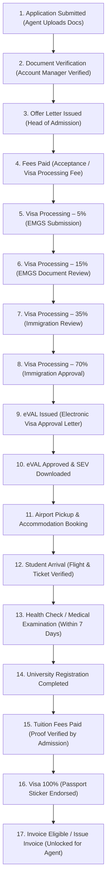
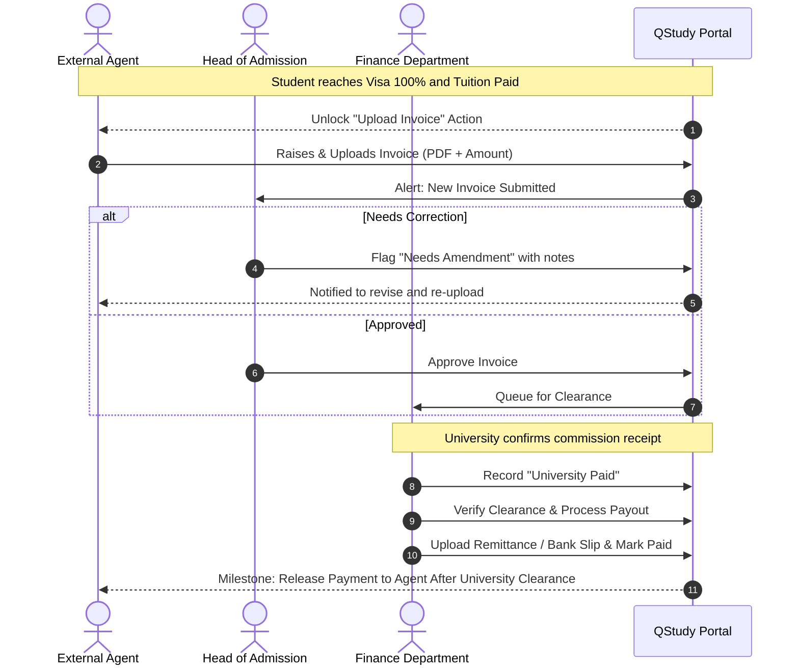

# 🌍 QStudy Agent Portal — Master Product Specification & Implementation Blueprint

> [!IMPORTANT]
> **Operational Alignment Update (2 November 2026 Comprehensive Review with Vijay):**
> Following the comprehensive live walkthrough with QStudy Leadership (**Vijay** - Client, **Ankush** - Lead Presenter/Product Lead, and **Anup/Anoop** - Developer), the portal has achieved **~80% completion**.
> 
> All legacy event/seminar seat-booking concepts have been fully decommissioned. The platform is strictly structured around **Malaysian International Education**, managing end-to-end **Student Applications & EMGS Visa Lifecycle Stages**, **Assigned University & Commission Visibility**, **Dedicated Account Manager Workspaces**, **Finance Department Payout Workflows**, and **Automated Agent Onboarding & E-Certification**.
> 
> This document is the **single authoritative source of truth** for all functional workflows, business rules, access matrices, and pending engineering deliverables.

---

# 📌 1. System Overview & Core Objectives

## 1.1 Purpose of the Platform
The **QStudy Agent Portal** is an enterprise education management portal designed to streamline operations between:
1. **QStudy Leadership & Operational Staff** (Head of Recruitment, Head of Admission, Account Managers, Finance)
2. **External Education Agencies / Sub-Agents** (Recruiting international students globally)
3. **Malaysian Higher Education Institutions** (105+ partner universities, colleges, and institutes)
4. **Prospective International Students** (Undergoing admissions, EMGS visa clearance, arrival, and registration)

## 1.2 Core Problem Solved
* **Elimination of Fragmented Tracking:** Replaces disparate spreadsheets, WhatsApp threads, and email chains with a unified status engine.
* **Malaysian EMGS Visa Compliance:** Mirrors the exact multi-stage visa progression regulated by Education Malaysia Global Services (EMGS) from initial application through final 100% passport sticker endorsement.
* **Preventing Platform Exploitation:** Restricts agent directory access via admin-controlled university and commission assignment, preventing external agents from using QStudy as a free database.
* **Streamlined Financial Clearances:** Enforces milestone-driven invoice generation, ensuring agents only invoice once students complete arrival, medical examination, university registration, and tuition settlement.

---

# 👥 2. User Roles, Access Matrix & Terminology Standardization

### ⚠️ Strict Terminology Rule: Rename "Accounts" $\rightarrow$ "Finance"
All occurrences of "Accounts" must be renamed to **"Finance"** throughout navigation bars, dashboards, role titles, notifications, and database enums. In QStudy operations, Finance handles university payment receipts, payment clearances, agent payouts, and remittance slip uploads. Finance does not issue student invoices or process admissions.

---

## 2.1 The 5 User Roles & Organizational Hierarchy

```text
               ┌────────────────────────────────────────────────────────┐
               │         Super Admin / CEO / Head of Recruitment         │
               │   (Global oversight, final approvals, visibility rules) │
               └───────────────────────────┬────────────────────────────┘
                                           │
         ┌─────────────────────────────────┴─────────────────────────────────┐
         ▼                                                                   ▼
┌─────────────────────────────────┐                       ┌─────────────────────────────────┐
│        Head of Admission        │                       │       Finance Department        │
│ (Offer letters, visa pipeline,  │                       │  (University clearance records, │
│  student admission approvals)   │                       │   agent payouts, bank slips)    │
└────────────────┬────────────────┘                       └─────────────────────────────────┘
                 │
                 ▼
┌─────────────────────────────────┐
│     Account Manager (SPOC)      │
│ (Dedicated to ~10 agents, file  │
│  verification, direct chat)     │
└────────────────┬────────────────┘
                 │
                 ▼
┌─────────────────────────────────┐
│     External Education Agent    │
│ (Student registration, document │
│  upload, view-only visa, invoice│
└─────────────────────────────────┘
```

### 1. External Education Agent
* Accesses only assigned Malaysian universities and published commission rates.
* Onboards via unique Account Manager referral links; signs contract and receives an automated E-Certificate.
* Submits student profiles and uploads mandatory academic and identification documents.
* **Strictly View-Only** access to student visa progress stages (percentages cannot be modified by agents).
* Raises commission invoices only after student tuition is verified and Visa 100% is reached.

### 2. Account Manager (Internal SPOC / Sales)
* Assigned a dedicated portfolio of agents (e.g., ~10 specific agents).
* **Restricted Workspace:** Can only view and manage their assigned agents and the students submitted by those agents.
* First verifier of student registration documents; moves verified applications to the admission stage.
* Communicates directly with assigned agents via 1-on-1 direct chat.
* Has a unique onboarding link that automatically binds newly registering agents to their account.

### 3. Admission Manager / Head of Admission (Internal Operations)
* Global visibility across all agents and students.
* Assesses academic eligibility and issues Offer Letters.
* **Sole Authority** to advance students through the EMGS Visa Pipeline ($5\% \rightarrow 100\%$).
* Verifies initial acceptance fees, post-arrival tuition payment proof, and university registration.
* Reviews agent invoices and grants invoice approval / requests amendments.

### 4. Finance Department (Internal Payouts & University Clearance)
* Global visibility across all agents, students, and invoices.
* Records receipt of tuition commission payments from universities ("University Paid").
* Verifies university payment clearance.
* Processes agent commission payouts and marks invoices as paid.
* Milestone naming standard: `Release Payment to Agent After University Clearance`.

### 5. Super Admin / CEO & Head of Recruitment (Executive Management)
* Global oversight of all modules, statistics, and system audit logs.
* Sets **University Visibility Rights** and **Commission Visibility Rules** per agent.
* Head of Recruitment verifies agent compliance documents during onboarding; CEO / Head of Admission gives final onboarding approval and issues contract.
* Includes supervisory filtering: can filter global dashboards by specific Account Manager (e.g., viewing performance specifically for Anup or Ankush).

---

## 2.2 Role & Feature Access Matrix

| Feature / Module | Agent | Account Manager | Head of Admission | Finance | Super Admin / CEO |
| :--- | :---: | :---: | :---: | :---: | :---: |
| **Agent Registration & Onboarding** | Submit Profile | View Assigned & Recommend | Approve & Issue Contract | View Bank Info | Full Approval & Activation |
| **E-Certificate Issuance** | View & Download | View Assigned | Config & Auto-Issue | View | Full Control / Revoke |
| **Students Management** | Submit & View Own | Verify Assigned Docs | Full Process & Review | View All | Full Access (All Agents) |
| **Visa Pipeline (5% ➔ 100%)** | **View-Only** | View Assigned | **Sole Edit Authority** | View Status | Full Administrative Edit |
| **University Catalog** | Assigned Only | View All | Manage Catalog | View All | **Assign Agent Access** |
| **Commission Visibility** | Assigned Only | View All | View All | View All | **Assign Agent Rates** |
| **Agent Invoice Submission** | Create (when eligible)| View Assigned | **Approve / Amend** | Process Payment | Full Oversight |
| **University Payment In** | No Access | No Access | View Status | **Record & Clear** | Full Control |
| **Payout Release & Slip Upload** | View Slip & Date | No Access | View Status | **Execute Payout** | Full Control |
| **Dedicated AM Chat** | 1-on-1 with AM | 1-on-1 with Agents | No | No | Monitor / Audit |
| **Staff Filter (By AM)** | N/A | N/A | **Yes** | **Yes** | **Yes** |
| **System Audit Logs** | No Access | No Access | No Access | No Access | **Exclusive Access** |

---

# 🎓 3. Consolidated Student Journey & Admission Workflow

### ⚠️ Sidebar Deduplication Mandate
The redundant standalone **"Applications"** menu item on the left-hand navigation sidebar must be **removed**. The entire lifecycle from lead/application through visa approval, arrival, and invoicing is managed centrally within the **"Students"** section to prevent process duplication.

---

## 3.1 The Complete 16-Stage Student Lifecycle



### Detailed Stage Breakdown & Operational Responsibilities

1. **Application Submitted:** Agent registers the student and uploads mandatory credentials:
   - Valid International Passport (all pages)
   - Passport-sized Photograph (blue/white background as required by EMGS)
   - Academic Certificates and Transcripts
   - English Proficiency Test Result (IELTS/TOEFL/PTE or Medium of Instruction letter)
2. **Document Verification:** Assigned **Account Manager** inspects uploaded files for completeness and legibility, then advances the file to the admissions queue.
3. **Offer Letter Issued:** **Head of Admission** reviews academic eligibility and uploads the official University Offer Letter / Acceptance Certificate.
4. **Fees Paid (Initial / EMGS):** Agent/Student submits payment receipt for visa processing and application fees; Admission marks fees verified.
5. **Visa Processing – 5%:** Application created and submitted into the EMGS portal.
6. **Visa Processing – 15%:** EMGS verifies documentation and requests any required clarifications.
7. **Visa Processing – 35%:** EMGS transmits vetted file to the Malaysian Immigration Department.
8. **Visa Processing – 70%:** Malaysian Immigration approves the application.
9. **eVAL Issued:** Electronic Visa Approval Letter (eVAL) generated and available for download.
10. **eVAL Approved & SEV:** Student downloads eVAL and obtains Single Entry Visa (SEV) where required.
11. **Airport Pickup & Accommodation Booking:** Logistics coordinates student arrival arrangements, campus accommodation, and airport reception.
12. **Student Arrival:** Student lands in Malaysia. Travel proof recorded (Flight Number, Date, Arrival Airport, Uploaded Ticket/Boarding Pass).
13. **Health Check / Post-Arrival Medical Examination:** Student completes the mandatory EMGS medical screening at an approved Malaysian clinic within 7 days of arrival.
14. **University Registration:** Student physically reports to campus, presents original documents, and completes university enrollment.
15. **Tuition Fees Paid:** Semester tuition fees are paid to the institution; Admission verifies tuition payment slip.
16. **Visa 100%:** Passport submitted to Immigration and endorsed with the physical Student Pass sticker. Application successfully completed.
17. **Invoice Eligibility:** Reaching Visa 100% automatically unlocks the invoice submission button on the agent portal.

---

## 3.2 Student Section UI & Filtration Requirements

* **Dashboard Header Cards:**
  - Rename the first generic card from *"Number of Applications"* to **"Applications"**.
  - Add dedicated status card: **"Offer Letter Issued"**.
* **Pipeline Counter Logic — Carry-Forward / Cumulative Funnel:**
  - Metric counters must flow over / carry forward. For example, students currently in Visa Processing must be counted in the upstream cumulative pipeline, preventing static or disconnected counts across stages.
* **Dual Display Views:**
  - **Box View:** Kanban/card-style cards showing student snapshot, profile picture, stage badge, and next action.
  - **Grid View:** High-density data table with sorting, pagination, and quick status badges.
* **Filter Sets:**
  - **University Filter:** Dropdown list of Malaysian institutions.
  - **Verification Status Filter:** `All Verification`, `Pending`, `Under Review`, `Verified`, `Rejected`.
  - **Document Completeness Filter:** `Complete`, `Missing`, `Pending`.

---

# 🏢 4. Malaysian University Directory & Visibility Controls

## 4.1 Strict Geographic Scope
* The university directory is **strictly limited to Malaysian Higher Education Institutions**.
* All foreign country filters and multi-country tabs must be removed.

## 4.2 Search, Filtration & Course Catalog
* **Program Level Filters:**
  - Foundation / Pre-University
  - Diploma
  - Bachelor's Degree
  - Master's Degree
  - PhD / Doctorate
* **Subject / Field of Study Filters:**
  - Business, Management & Marketing
  - Information Technology, Computer Science & AI
  - Accounting & Finance
  - Engineering & Built Environment
  - Hospitality, Tourism & Culinary Arts
  - Allied Health, Nursing & Pharmacy
* **Program Detail Cards:**
  - University Overview & Accreditations (MQA)
  - Program Intakes (e.g., March, July, October)
  - Tuition Fees & Incidental Costs (MYR)
  - Available Scholarships & Waivers
  - Downloadable University Brochure (PDF)
  - Downloadable Fee Structure Brochure (PDF)
  - Direct **"Apply Now"** button linking directly to the Student Application form with university/program pre-selected.

## 4.3 Super Admin Visibility Assignment Matrix
To protect QStudy's proprietary institutional relationships and prevent external agents from using the portal as an open directory:
* The Super Admin panel must feature an **Assignment Checklist / Toggle Matrix**.
* Super Admin selects specifically which universities and programs each agent is permitted to view.
* Agents can only browse and submit applications to institutions explicitly assigned to their account.

---

# 💰 5. Commission Management & Invoice Payout Workflow

## 5.1 Commission Visibility Logic
* Following the same principle as universities, commission structures are published on an **assignment basis**.
* Super Admin selects which commission rules or percentage bands are visible to each agent.
* Commission rates are configured at the institution and program level, restricted to Malaysian universities.

## 5.2 End-to-End Invoice Payout Lifecycle



### Confirmed Lifecycle Stages:
1. **Invoice Submitted:** Agent uploads commission invoice after student reaches Visa 100%.
2. **Head of Admission Review:** Checks invoice calculations against registered student count and either approves or flags for amendment.
3. **University Paid:** Finance records that the commission payment from the university has been deposited into QStudy's corporate account.
4. **Invoice Processing & Clearance:** Finance verifies payment terms and clearance.
5. **Release Payment to Agent After University Clearance:** Finance executes bank transfer, uploads the payment advice/slip, and marks invoice as settled.

## 5.3 Commission & Payoff Dashboard Widget
* Display real-time status widgets:
  - **Paid to You** (Historical settled payouts)
  - **Waiting for Payment** (Approved invoices awaiting university clearance/payout)
  - **Total Commission Earned**
* Table view showing invoice number, student name, university, submission date, current stage, clearance status, and download links for uploaded invoice and remittance slip.

---

# 🧑‍💼 6. Dedicated Account Manager Workspace & Supervisory Views

## 6.1 Account Manager Dedicated Experience
Account Managers are sales facilitators assigned to dedicated agency accounts. Their interface must enforce strict isolation:
* **Dedicated Agent Scope:** An Account Manager assigned to 10 agents can only see data belonging to those 10 agents.
* **Dynamic Cascade Selectors:**
  1. **Agent Dropdown:** Allows selecting from their assigned agents.
  2. **Student Dropdown:** Once an agent is selected, a student dropdown dynamically populates with all students submitted by that agent, sorted with the **latest students on top**.
* **Quick Search Filters:** Fast keyword search by Student Name, Passport Number, and Country within the assigned pool.
* **Bottom-Right Agent Profile Summary Card:**
  - A persistent widget in the bottom-right corner of the Account Manager screen displaying key metadata of the selected agent:
    - Agency Legal Name & Agent ID (e.g., `GEA0001IND`)
    - Person-in-Charge (PIC) Name & Direct Phone/WhatsApp
    - Active Students Count & Total Invoiced Amount
    - Quick Action: Initiate Direct 1-on-1 Chat

## 6.2 Leadership Global Oversight & Staff Performance Filtering
* **Head of Recruitment, Head of Admission, and Finance** have global visibility across all agents and students.
* **Account Manager Filter:** An additional supervisory dropdown filter allows leadership to inspect the portal from the perspective of any specific Account Manager (e.g., *"Filter by Account Manager: Anup"*).

---

# 📝 7. Agent Onboarding, Unique Links & Automated E-Certification

## 7.1 Unique Registration Referral Links
* Every Account Manager has a dedicated referral link (e.g., `https://portal.qstudy.my/register?am=AM-ANKUSH-01`).
* When an external agency registers through this link, the system **automatically assigns the agency to that Account Manager**.

## 7.2 The 10-Step Onboarding & Activation Flow

```text
1. Account Manager shares unique registration link with prospective agency.
     ↓
2. Agency completes the 3-step profile form (Company info, bank details, 1 document).
     ↓
3. Account Manager reviews submission and recommends for approval.
     ↓
4. Head of Recruitment verifies submitted company credentials.
     ↓
5. CEO / Head of Admission reviews and approves the agency.
     ↓
6. CEO / Head of Admission issues the official Partnership Contract.
     ↓
7. Agency signs the contract and uploads the executed digital copy.
     ↓
8. Head of Admission / CEO activates the automated E-Certificate generator.
     ↓
9. System auto-generates E-Certificate (agent legal name, issue date, validity period).
     ↓
10. Agent account is marked Active and full portal access is unlocked.
```

### Form Simplification Rules:
* **Step 1: Corporate Details:** Agency Name first, Registration Number, Official Address, Country, PIC Name & Designation, Phone, Email.
* **Step 2: Bank Particulars:** Bank Name, Branch, Beneficiary Name, Account Number/IBAN, SWIFT/BIC.
* **Step 3: Document Uploads:** **Any ONE document is sufficient** (Company Profile, Business Registration Certificate, or Director Passport). No blank forms or redundant multi-document mandates.

## 7.3 Dedicated Agent Registration Guide Page
* Create a dedicated user-facing page: **"Agent Registration Guide"**.
* Features:
  - Downloadable/displayable **QR Code** for instant mobile registration.
  - Step-by-step visual guide on registration, mandatory document preparation, contract e-signing, and E-Certificate issuance.

---

# 📊 8. Dashboard Intelligence & Reporting Modules

## 8.1 Agent Dashboard Components
* **Today's Activity Card:**
  - Students Added Today
  - Applications Submitted
  - Invoices Raised
  - Status Changes
  - Payouts Received Today
* **Need Your Action Card:**
  - Highlighted actionable alerts (e.g., document re-upload requested, offer letter ready for acceptance, invoice amendment needed, open support tickets).
* **At a Glance Metrics:**
  - Total Students, Active Applications, Invoices Raised, Assigned Universities, Enrolled Programs, Total Commission.
* **Work History (14 Days):**
  - Activity feed with date filter presets: `Today`, `Yesterday`, `This Week`, `One Month`.
* **News & Updates:**
  - Broadcast bulletins and intake deadlines published by QStudy Admin.

---

# 🛠️ 9. Concrete Implementation Action Plan & Priority Roadmap

### Priority Level Definitions:
* 🔴 **P0 (Critical / Blocker):** Direct client redlines from the 2 Nov walkthrough. Must be deployed before the next client review. Breaking workflows if absent.
* 🟡 **P1 (High Priority):** Core operational mechanics, permission enforcements, and data isolation logic. Required for stable day-to-day operations.
* 🟢 **P2 (Medium Priority):** Secondary UI widgets, onboarding documentation, and dashboard historical filters.

---

## 🚦 9.1 Master Priority Matrix

| Task ID | Item Description | Priority | Target Layer | Owner |
| :--- | :--- | :---: | :---: | :---: |
| **A.1** | Remove separate "Applications" sidebar menu; consolidate in "Students" | 🔴 **P0** | Frontend | Dev Team |
| **A.2** | Rename all occurrences of "Accounts" $\rightarrow$ "Finance" across portal | 🔴 **P0** | Fullstack / DB | Dev Team |
| **B.1** | Rename card to "Application" and add "Offer Letter Issued" card | 🔴 **P0** | Frontend | Dev Team |
| **B.3** | Implement 16-stage Student Lifecycle & EMGS Visa progress engine | 🔴 **P0** | Fullstack / DB | Dev Team |
| **B.4** | Enforce stage permissions: AM verifies docs, Admission controls Visa $5\%\to 100\%$ | 🔴 **P0** | Backend API | Dev Team |
| **C.1** | Restrict University Directory to Malaysia only (purge country filters) | 🔴 **P0** | Frontend / API | Dev Team |
| **C.3** | Build Super Admin University Assignment Matrix (toggle per agent) | 🔴 **P0** | Fullstack | Dev Team |
| **C.4** | Enforce agent query filtering to assigned universities only | 🔴 **P0** | Backend API | Dev Team |
| **D.2** | Lock "Upload Invoice" button until student hits Visa 100% & Tuition Paid | 🔴 **P0** | Fullstack | Dev Team |
| **D.4** | Payout milestone: `"Release Payment to Agent After University Clearance"` | 🔴 **P0** | Fullstack | Dev Team |
| **E.1** | Restrict Account Manager queries strictly to their assigned agents | 🔴 **P0** | Backend API | Dev Team |
| **E.2** | Build AM Cascade Dropdowns: Agent selector $\to$ Students (latest on top) | 🔴 **P0** | Frontend / API | Dev Team |
| **F.1** | Implement unique AM referral registration links with auto-assignment | 🔴 **P0** | Backend / Auth | Dev Team |
| **A.3** | Re-group university catalogs and institutional data under "Info" | 🟡 **P1** | Frontend | Dev Team |
| **B.2** | Implement pipeline carry-forward / cumulative count logic | 🟡 **P1** | Fullstack | Dev Team |
| **B.5** | Add University, Verification Status & Completeness filters (Box & Grid) | 🟡 **P1** | Frontend | Dev Team |
| **C.2** | Implement Program Level (Foundation-PhD) & Subject Field filters | 🟡 **P1** | Frontend / API | Dev Team |
| **D.1** | Implement Admin Commission Structure Assignment Matrix | 🟡 **P1** | Fullstack | Dev Team |
| **D.3** | Build Head of Admission invoice review, approval & amendment interface | 🟡 **P1** | Fullstack | Dev Team |
| **D.5** | Render Commission Summary: "Paid to You", "Waiting for Payment", "Total" | 🟡 **P1** | Frontend | Dev Team |
| **E.3** | Build bottom-right Agent Profile Summary widget in AM workspace | 🟡 **P1** | Frontend | Dev Team |
| **E.4** | Add supervisory AM filter for Head of Recruitment, Admission & Finance | 🟡 **P1** | Frontend / API | Dev Team |
| **F.2** | Implement simplified 3-step registration form (Company first, 1 doc) | 🟡 **P1** | Frontend | Dev Team |
| **F.3** | Build automated E-Certificate generator modal (name, date, validity) | 🟡 **P1** | Fullstack | Dev Team |
| **F.4** | Create dedicated Agent Registration Guide page with QR code instructions | 🟢 **P2** | Frontend | Dev Team |
| **8.1** | Add 14-day work history date filters (`Today`, `Yesterday`, `Week`, `Month`) | 🟢 **P2** | Frontend | Dev Team |

---

## 📋 9.2 Phased Action Checklist

### Phase A: Navigation, Naming & Sidebar Consolidation
- [x] 🔴 **[P0] A.1 (Consolidate Sidebar):** Remove the redundant standalone "Applications" menu item from the sidebar; consolidate all application and student management under the unified **"Students"** section. (Completed: Sidebar links removed, /applications redirected to /students, application tracking embedded directly in student views and drawers, and student registration directly submits university course application).
- [x] 🔴 **[P0] A.2 (Role Naming Standardization):** Rename all UI display occurrences of "Accounts" to **"Accounts/Finance"** across navigation bars, headers, role badges, and dialogs (preserving `accounts` DB role enum).
- [x] 🟡 **[P1] A.3 (Rename Info Menu):** Ensure university catalogs and institutional information are grouped under **"Info"** or "Universities".

---

### Phase B: Student Section & Visa Pipeline Refinement
- [x] 🔴 **[P0] B.1 (Card Labels):** Rename the first student header card from "Number of Applications" to **"Application"** and add an **"Offer Letter Issued"** summary card.
- [x] 🟡 **[P1] B.2 (Cumulative Pipeline Counters):** Implement carry-forward / flow-over logic so student counts in pipeline stages reflect active stage movement without double counting.
- [x] 🔴 **[P0] B.3 (16-Stage Student Lifecycle Engine):** Implement the sequential status transition:
  `Application Submitted` $\rightarrow$ `Document Verification` $\rightarrow$ `Offer Letter Issued` $\rightarrow$ `Fees Paid` $\rightarrow$ `Visa 5%` $\rightarrow$ `Visa 15%` $\rightarrow$ `Visa 35%` $\rightarrow$ `Visa 70%` $\rightarrow$ `eVAL Issued` $\rightarrow$ `eVAL Approved` $\rightarrow$ `Pickup & Accommodation` $\rightarrow$ `Student Arrival` $\rightarrow$ `Medical Exam` $\rightarrow$ `Univ Registration` $\rightarrow$ `Tuition Fees Paid` $\rightarrow$ `Visa 100%` $\rightarrow$ `Invoice Eligible`.
- [x] 🔴 **[P0] B.4 (Role-Based Stage Permissions):** Enforce strict backend validation:
  - Account Manager & Head of Recruitment verify documents and student verification queue.
  - Head of Admission has sole authority to issue offer letters and advance Visa $5\% \rightarrow 100\%$.
  - Agents have **view-only** permissions over visa progress bars.
- [x] 🟡 **[P1] B.5 (Filters & Views):** Verify Box and Grid view toggle functionality; ensure filter dropdowns for Pipeline Stage, University, Verification Status (`Pending`, `Under Review`, `Verified`, `Rejected`), and Document Completeness (`Complete`, `Missing`, `Pending`) work seamlessly.

---

### Phase C: University Directory & Admin Visibility Matrix
- [x] 🔴 **[P0] C.1 (Malaysian Only Scope):** Remove all non-Malaysian country filters; restrict directory and commission tables strictly to Malaysian institutions.
- [x] 🟡 **[P1] C.2 (Directory Filters):** Implement filter chips and dropdowns for Program Level (Foundation, Diploma, Degree, Bachelor, Master, PhD) and Fields of Study (Business, IT, Accounting, Engineering, Hospitality, Health, etc.).
- [x] 🔴 **[P0] C.3 (Admin Assignment Matrix):** Create an admin control modal/screen allowing Super Admin / Head of Admission to check/uncheck Malaysian universities and commission structures accessible to each specific agent.
- [x] 🔴 **[P0] C.4 (Agent View Enforcement):** Filter agent university and course queries based on the agent's explicit assigned Malaysian university list.
- [x] 🔴 **[P0] C.5 (MYR / RM Currency & Local vs. International / Nationality Fee Tiers):** Default program and university fees to `MYR (RM)` and support dual **International Student** vs. **Local (Malaysian) Student** tuition fees alongside optional **Nationality-Specific Tuition Tiers** across course modals, directories, detail views, and student registration.

---

### Phase D: Commission & Invoice Lifecycle
- [x] 🟡 **[P1] D.1 (Commission Assignment):** Implement admin toggle matrix to publish specific Malaysian university commission structures to assigned agents.
- [x] 🔴 **[P0] D.2 (Invoice Gating):** Keep the "Upload Invoice" button locked until a student's record reaches `Visa 100%` and `Tuition Fees Paid`.
- [x] 🟡 **[P1] D.3 (Admission Approval & Amendment):** Build interface for Head of Admission to approve invoice or flag "Needs Amendment" with notes.
- [x] 🔴 **[P0] D.4 (Finance Payout Flow & Milestone Label):** Build Accounts/Finance portal actions for recording "University Paid" and releasing payouts with mandatory payment slip attachment. Label final milestone: **`Release Payment to Agent After University Clearance`**.
- [x] 🟡 **[P1] D.5 (Commission Dashboard):** Render the Payoff summary card: "Paid to You", "Waiting for Payment", and "Total Commission".

---

### Phase E: Account Manager Workspace & Supervisory Filters
- [x] 🔴 **[P0] E.1 (AM Isolation):** Restrict Account Manager queries strictly to their assigned agents.
- [x] 🔴 **[P0] E.2 (Cascade Dropdowns):** Build Agent Selector dropdown that triggers dynamic loading of the Student dropdown (latest students on top).
- [x] 🟡 **[P1] E.3 (Agent Profile Bottom-Right Widget):** Build the bottom-right summary widget displaying legal name, Agent ID, PIC contact info, active student count, and direct chat button.
- [x] 🟡 **[P1] E.4 (Supervisor AM Filter):** Provide an Account Manager filter dropdown for Head of Recruitment, Head of Admission, Accounts/Finance, and Super Admin.

---

### Phase F: Agent Onboarding, E-Certificates & Registration Guide
- [x] 🔴 **[P0] F.1 (Unique AM Links):** Generate unique referral URLs per Account Manager; automatically bind registered agents to that AM on account creation.
- [x] 🟡 **[P2] F.2 (Simplified 3-Step Form):** Update registration form: Company Name first, single document upload required, complete banking particulars.
- [x] 🟡 **[P1] F.3 (Automated E-Certificate Generator):** Build automated E-Certificate generator allowing admin to specify Agency Legal Name, Issue Date, and Validity Period, generating a branded downloadable certificate.
- [x] 🟢 **[P2] F.4 (Agent Registration Guide Page):** Build the registration guide section with QR code instructions and 3-step onboarding breakdown.
- [x] 🟢 **[P2] 8.1 (14-Day Work History Date Filters):** Add `All Time`, `Today`, `Yesterday`, `This Week`, and `One Month` date filter presets to the Dashboard Work History timeline.

---

# 📦 10. Deliverables to Be Shared with Client (Vijay)

1. **Typed Role & Responsibilities Matrix:** Delivered as editable text (not screenshots) so the client can copy, paste, and mark amendments.
2. **Student Application Stage Workflow:** Delivered as a visual flowchart/screenshot confirming the updated sequential pipeline.
3. **Agent Registration Guide:** Step-by-step document including mobile QR code onboarding.
